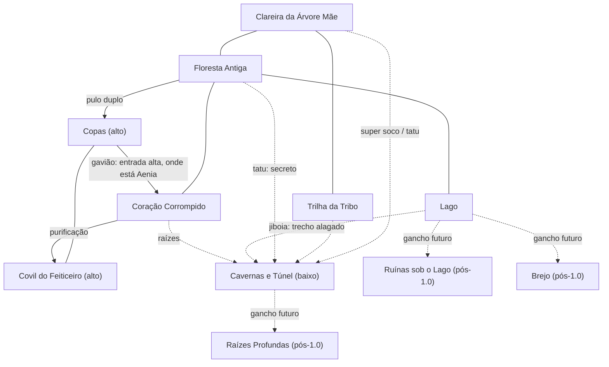

# Two Souls — brainstorm do mundo interligado

Sessão de brainstorm entre o Gabriel e o Claude, 01/11/2026. Branch `claude/brainstorm-mundo`.

**Legenda de origem:**
- **[Gabriel]**: decisão ou lembrança do Gabriel.
- **[proposta]**: sugestão do Claude aprovada pelo Gabriel.
- **[opinião]**: avaliação do Claude, não decidida.
- Nomes de regiões, subchefes e habilidades novas são **provisórios**.

---

## Tema 1 — Mapa da floresta de Monte Ligna

### Decisões aprovadas

1. **Mapa único e contínuo** [Gabriel]: sem seleção de fases. "Região" é só o nome de uma parte do mapa. Detalhe técnico assumido: o Godot carrega sala por sala, com transição rápida.
2. **Formato híbrido das alturas** (opção C) [proposta]: cada região tem um tema e usa 2 ou 3 alturas (alto, chão, baixo). As camadas também ligam regiões vizinhas, servindo de atalho ou rota secreta.
3. **Tamanho: mapa grande lançado por partes** (opção B) [Gabriel]: o Gabriel quer um jogo grande, "como o Hollow Knight: Silksong". O mapa inteiro é desenhado já agora, com uns 13 a 15 regiões. O **1.0 sai com 8 regiões** e uma história completa, de 12 a 18 horas. O restante entra como ganchos trancados, liberados em atualizações ou expansão.
4. **Cavernas e túneis formam uma rede embaixo do mapa inteiro** [Gabriel]: o Túnel lembrado é a linha principal. Dá para descer até a Clareira, a Trilha, a Floresta, o Lago e o Coração Corrompido.
5. **Atalhos secretos, em dois tipos** (opção C) [Gabriel + proposta]:
   - **Atalhos de volta** (porta que só abre por um lado, parede quebrável perto de checkpoint): pista visível no cenário.
   - **Segredos de recompensa** (itens, salas extras, desafios de precisão): escondidos de verdade, fora do minimapa até serem achados.
6. **Checkpoints: só santuários fixos** (opção A) [Gabriel]:
   - Uns 2 ou 3 por região. Salvam, recuperam vida e magia e fazem os inimigos voltarem.
   - **Todo desafio muito difícil tem um santuário perto.**
   - O santuário só vale como ponto de retorno se o jogador **ativá-lo**. Ao morrer, o jogador volta ao último santuário ativado, mesmo que esteja longe.
7. **Morrer não tira nada** (opção A) [Gabriel]: o jogador volta ao santuário com tudo. O castigo é só a caminhada.

### Regiões (esboço)

**1.0 — 8 regiões**

| # | Região | Alturas | Conteúdo |
|---|---|---|---|
| 1 | Clareira da Árvore Mãe | chão + caverna embaixo | início (manhã), centro do mapa |
| 2 | Trilha da Tribo | chão, plataformas de madeira | The Rock |
| 3 | Floresta Antiga | chão + caverna embaixo | ligação central |
| 4 | Copas | alto (sobre a Floresta Antiga) | desafios de precisão |
| 5 | Cavernas e Túnel | baixo (rede sob o mapa) | Túnel lembrado [Gabriel], atalhos |
| 6 | Lago | superfície, fundo (mergulho) | subchefe do mergulho |
| 7 | Coração Corrompido | chão, raízes, caverna | Árvore Corrompida (pôr do sol) |
| 8 | Covil do Feiticeiro | alto (topo do Monte Ligna) | chefe final (noite) |

**Ganchos para depois do 1.0 (trancados no mapa):** Brejo (Serpe do Brejo), Raízes Profundas, Ruínas sob o Lago, Pico Nevado, Bosque de Aenia.

### Mapa de conexões

As linhas tracejadas são passagens subterrâneas ou secretas. Os rótulos mostram a habilidade que abre cada caminho.

### Alternativas descartadas

- **Regiões lado a lado, uma por ambiente:** isolaria os ambientes, com sensação de "fase da caverna".
- **Camadas empilhadas puras:** difícil de desenhar e de mostrar no minimapa.
- **6 regiões, de 60 a 80 salas:** curto demais para o que o Gabriel quer.
- **Tamanho Silksong já no 1.0:** prazo longo e risco alto de o jogo travar no meio [opinião].
- **8 a 10 regiões fechadas:** perde o plano de crescer depois.
- **Segredos sempre com pista visível:** tira a graça de explorar.
- **Checkpoint a cada sala:** a exploração perde o peso.
- **Pontos de retorno automáticos nos desafios:** o Gabriel preferiu santuários de verdade perto dos desafios difíceis.
- **Perder essência ao morrer** (deixar no chão ou perder uma parte): o Gabriel preferiu não punir.

---

## Tema 2 — Habilidades que abrem caminhos

> **Revisado no bloco 2** (ver `brainstorm-jogo.md`). Agora são **7 habilidades**, cada uma com um espírito animal [Gabriel]:
>
> | Ordem | Habilidade | Onde ganha |
> |---|---|---|
> | 1 | Lança cravada (humano) | Clareira |
> | 2 | Super soco (humano, presente de The Rock): foco em combate, quebra algumas pedras no caminho | The Rock |
> | 3 | Onça-pintada preta: corrida livre com duração e recarga | subchefe da Floresta Antiga |
> | 4 e 5, em qualquer ordem | Jiboia: mergulho, frestas e escalar árvores | subchefe do Lago |
> | | Tatu-canastra: cavar terra fofa, túneis e segredos das cavernas (ferramenta principal do mapa) | subchefe do Túnel |
> | 6 | Gavião-real (harpia): pulo duplo. Abre as Copas e a entrada alta do Coração, onde Aenia está | subchefe das Cavernas profundas (exige jiboia e tatu) |
> | 7 | Purificação (os gêmeos) | resgate de Aenia; abre o Covil |
>
> Mudanças:
> - Os "dois selos" do Coração **foram removidos**.
> - O planar fica com o gavião, depois do 1.0.
> - O gancho e o cipó ficam com Orion em forma humana, depois do 1.0.
> - O macaco-prego foi descartado.
>
> As tabelas abaixo ficam como histórico.

### Decisões aprovadas

1. **5 habilidades de travessia no 1.0** [proposta]: lança cravada, super soco, purificação, pulo duplo, mergulho.
2. **Gancho de vinha e planar ficam para as regiões pós-1.0** [Gabriel].
3. **Ordem "A com um toque de C"** [proposta]: a lança e o super soco vêm sempre nessa ordem. O pulo duplo e o mergulho podem ser pegos em qualquer ordem, mas os dois são obrigatórios antes do resgate. A purificação vem no resgate de Aenia.

| Ordem | Habilidade | Origem | Onde ganha | O que abre |
|---|---|---|---|---|
| 1 | Lança cravada (arremessa, crava na parede, vira degrau) | lança e arremesso: [Gabriel]; usar como degrau: [proposta] | Clareira, no início | paredes altas da Floresta e da Trilha |
| 2 | Super soco | [Gabriel] (vem de vencer The Rock) | The Rock | rochas e paredes rachadas, entrada das Cavernas |
| 3 ou 4 | Pulo duplo (vento ou folha) | [proposta] | subchefe nas Cavernas ou na Floresta | Copas, caminho alto até o Covil |
| 3 ou 4 | Mergulho | [proposta] | subchefe do Lago | fundo do Lago, trecho alagado do Túnel |
| 5 | Purificação (magia dos gêmeos) | magia dos gêmeos após o resgate: [Gabriel]; usar contra barreiras: [proposta] | resgate de Aenia (vencer a Árvore Corrompida) | barreiras de corrupção, Covil |

**Atualizado pelo tema 3:** a entrada do Coração Corrompido exige **pulo duplo e mergulho** (dois selos), não a purificação.

### Alternativas descartadas

- **4 habilidades, sem mergulho:** o lago ficaria só na superfície.
- **7 habilidades no 1.0:** muito trabalho de animação e de desenho de fases. Gancho e planar foram adiados, não descartados.
- **Super soco antes da lança:** a lembrança é que Orion já parte com a lança.
- **Ordem totalmente livre depois do super soco:** difícil de balancear. Foi adotada só entre pulo duplo e mergulho.

---

## Tema 3 — Chefes, subchefes e minibosses

### Decisões aprovadas

1. **The Rock vem antes da Árvore Corrompida** [decisão da refeitura]: é consequência do tema 2, já que o super soco é a 2ª habilidade. Não é lembrança do original; o original continua sem ordem confirmada.
2. **A Árvore Corrompida guarda Aenia** (opção A) [proposta]:
   - O feiticeiro prende Aenia no Coração Corrompido.
   - Vencer a árvore ao pôr do sol liberta Aenia e traz a purificação.
   - A purificação abre o Covil, onde o final acontece à noite.
   - Isso encaixa na lembrança do Gabriel: árvore ao pôr do sol e o final à noite.
3. **Feiticeiro e lagarto: o feiticeiro se transforma** (opção B) [decisão da refeitura]:
   - Fase 1: feiticeiro encapuzado, com magia e projéteis.
   - Fase 2: absorve a corrupção e vira o lagarto meio dragão encapuzado, com garras e meteoros.
   - O Gabriel não indicou que isso seja lembrança do original.
4. **16 lutas no 1.0: 3 principais, 5 subchefes e 8 minibosses** (opção B) [Gabriel].

| Tipo | Luta | Região | Recompensa |
|---|---|---|---|
| Principal | The Rock (testa Orion, depois vira aliado) [Gabriel] | Trilha da Tribo | super soco |
| Principal | Árvore Corrompida (raízes, vinhas) [Gabriel] | Coração Corrompido | resgate de Aenia e purificação |
| Principal | Feiticeiro → lagarto encapuzado (meteoros) | Covil do Feiticeiro | final |
| Subchefe | a definir | Cavernas | pulo duplo |
| Subchefe | a definir | Lago | mergulho |
| Subchefe | a definir | Copas | caminho até o Covil |
| Subchefe | a definir | Túnel | travessia de baixo |
| Subchefe | a definir | Floresta Antiga | um dos selos do Coração |
| Miniboss ×8 | variações mais fortes de inimigos comuns, com golpes novos [proposta] | 1 por região | vida máxima, talento ou item |

A distribuição dos subchefes e minibosses é **provisória**. A Serpe do Brejo sai do 1.0 e vai para a região Brejo, depois do lançamento.

### Alternativas descartadas

- **Resgate no meio do jogo, nas Cavernas:** afastaria a árvore do resgate e do pôr do sol.
- **Resgate só no final:** a magia dos gêmeos deixaria de ser habilidade de travessia.
- **Feiticeiro e lagarto iguais desde o início, ou dois personagens separados:** a transformação dá duas fases ao final e aproveita as duas imagens antigas.
- **12 lutas (3 + 3 + 6) e 8 lutas (3 + 2 + 3):** o Gabriel quer densidade maior. [opinião] Cada luta custa arte, animação e balanceamento; reaproveitar inimigos nos minibosses reduz esse custo.

---

## Tema 4 — Relógio de 24 h e exploração livre

### Decisões aprovadas

1. **Vários dias, com descanso no santuário** (opção B) [proposta]:
   - O ciclo de 24 h roda livre e a jornada dura vários dias.
   - No santuário o jogador descansa até de manhã ou até a noite.
   - Cada chefe principal fixa o seu horário ao entrar na arena.
   - A narrativa vira "a jornada até o ritual do feiticeiro", não "tudo num dia só".
   - Não há cronômetro de tempo limite.
2. **Três modos de dificuldade, ligados ao relógio** [Gabriel]:

| Modo | Relógio | Público |
|---|---|---|
| História | quase sempre de dia; noite só para o chefe final | quem quer história e exploração com calma |
| Aventura | padrão: vários dias, descanso, chefes fixam a hora | experiência principal |
| Desafio | o jogo inteiro à noite, com inimigos mais fortes e ferozes | quem gosta de Dark Souls e jogos hardcore |

3. **No Desafio, os chefes também lutam à noite, em versão noturna** (opção A) [proposta]:
   - Mais vida, mais velocidade e menos tempo entre golpes.
   - No 1.0 isso é só números mais um efeito visual. Golpes novos ficam para depois.
4. **Troca de modo** (opção B) [proposta]:
   - Entre História e Aventura, livre, em qualquer santuário.
   - O Desafio só pode ser escolhido no início. Quem sair dele não volta, e perde a conquista da Steam de terminar no Desafio.

### Alternativas descartadas

- **Um dia só, com travas no relógio:** a noite quase só apareceria no fim, e o sistema pedido ficaria escondido.
- **Relógio só visual:** remove a dificuldade noturna que o Gabriel pediu.
- **Chefes mantendo o horário da história no Desafio:** contradiz "o jogo inteiro à noite".
- **Chefes iguais no Desafio:** o desafio dos chefes não mudaria.
- **Troca de modo totalmente livre:** o Desafio deixaria de ser uma medalha.
- **Modo fixo do início ao fim:** quem travar num chefe teria de recomeçar o jogo.

---

## Tema 5 — Escopo da demo e do 1.0

> **Revisado no bloco 4** (`plano-de-negocio.md`): a demo **deixou de ser meta**. O foco é o jogo completo, sem data. A demo será o recorte abaixo, tirado do jogo pronto, no Next Fest anterior ao lançamento. **The Rock passou a se chamar D Rock**, por risco de marca.

### Decisões aprovadas

1. **1.0:** 8 regiões, 16 lutas, 5 habilidades de travessia, 3 modos, de 12 a 18 horas (temas 1 a 4).
2. **Demo do Steam Next Fest: do início até vencer The Rock** (opção A) [proposta]:
   - Uns 45 a 60 minutos.
   - Regiões: Clareira, Trilha da Tribo e a entrada das Cavernas.
   - Mostra a lança cravada, o super soco e uma parede rachada que ele abre.
   - Termina com o gancho "o resto da floresta está aberto".

[opinião] Com 16 lutas e 3 modos, este é um projeto de vários anos para uma pessoa com IA. A demo deve ser pequena e muito bem acabada, e o cronograma real fica para o `plano-de-negocio.md`.

### Alternativas descartadas

- **Demo de uma região só:** mostra pouco do mundo interligado.
- **Demo de 3 ou 4 regiões:** atrasa a demo e gasta conteúdo do jogo.

---

## Perguntas em aberto

- **Mapa:** quantas salas por região, e o nome final de cada região.
- **Minimapa:** escala, ícones, e se o mapa é comprado, achado ou revelado andando.
- **Subchefes e minibosses:** quem são, os golpes, e a distribuição final.
- **Ritual:** quando o ritual do feiticeiro acontece na história, e se existe alguma consequência por demorar. A proposta atual é não ter tempo limite.
- **Demo:** se a demo oferece o modo Desafio.
- **Escala do relógio:** quanto tempo dura um dia de jogo (o protótipo usa 15 min) e quais são os horários exatos dos chefes. O protótipo usa 10:00, 18:00 e 22:00.
- **Pós-1.0:** o que existe nas regiões-gancho, quais delas usam o gancho de vinha e o planar, e se elas chegam em atualização gratuita ou numa expansão paga.
- **Original:** a ordem real entre The Rock e a árvore no jogo da faculdade continua sem confirmação. A ordem acima é decisão da refeitura.
