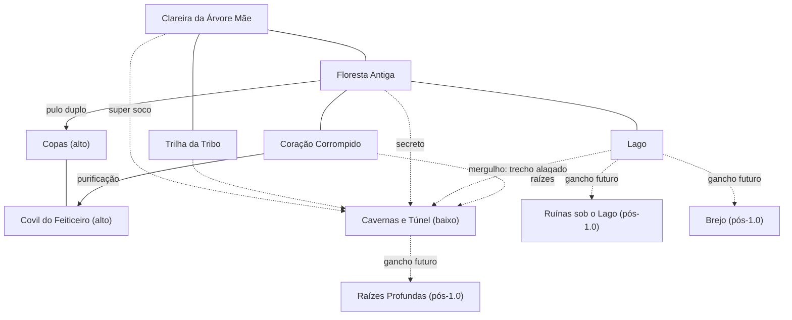

# Two Souls — brainstorm do mundo interligado

Sessão de brainstorm entre o Gabriel e o Claude, 01/11/2026. Branch `claude/brainstorm-mundo`.

**Legenda de origem:**
- **[Gabriel]**: decisão ou lembrança do Gabriel.
- **[proposta]**: sugestão do Claude aprovada pelo Gabriel.
- **[opinião]**: avaliação do Claude, não decidida.
- Nomes de regiões, subchefes e habilidades novas são **provisórios**.

---

## Tema 1 — Mapa da floresta de Monte Ligna

### Decisões aprovadas

1. **Mapa único e contínuo** [Gabriel]: sem seleção de fases. "Região" é só o nome de uma parte do mapa. Detalhe técnico assumido: o Godot carrega sala por sala, com transição rápida.
2. **Formato híbrido das alturas** (opção C) [proposta]: cada região tem um tema e usa 2 ou 3 alturas (alto, chão, baixo). As camadas também ligam regiões vizinhas, servindo de atalho ou rota secreta.
3. **Tamanho: mapa grande lançado por partes** (opção B) [Gabriel]: o Gabriel quer um jogo grande, "como o Hollow Knight: Silksong". O mapa inteiro é desenhado já agora, com uns 13 a 15 regiões. O **1.0 sai com 8 regiões** e uma história completa, de 12 a 18 horas. O restante entra como ganchos trancados, liberados em atualizações ou expansão.
4. **Cavernas e túneis formam uma rede embaixo do mapa inteiro** [Gabriel]: o Túnel lembrado é a linha principal. Dá para descer até a Clareira, a Trilha, a Floresta, o Lago e o Coração Corrompido.
5. **Atalhos secretos, em dois tipos** (opção C) [Gabriel + proposta]:
   - **Atalhos de volta** (porta que só abre por um lado, parede quebrável perto de checkpoint): pista visível no cenário.
   - **Segredos de recompensa** (itens, salas extras, desafios de precisão): escondidos de verdade, fora do minimapa até serem achados.
6. **Checkpoints: só santuários fixos** (opção A) [Gabriel]:
   - Uns 2 ou 3 por região. Salvam, recuperam vida e magia e fazem os inimigos voltarem.
   - **Todo desafio muito difícil tem um santuário perto.**
   - O santuário só vale como ponto de retorno se o jogador **ativá-lo**. Ao morrer, o jogador volta ao último santuário ativado, mesmo que esteja longe.
7. **Morrer não tira nada** (opção A) [Gabriel]: o jogador volta ao santuário com tudo. O castigo é só a caminhada.

### Regiões (esboço)

**1.0 — 8 regiões**

| # | Região | Alturas | Conteúdo |
|---|---|---|---|
| 1 | Clareira da Árvore Mãe | chão + caverna embaixo | início (manhã), centro do mapa |
| 2 | Trilha da Tribo | chão, plataformas de madeira | The Rock |
| 3 | Floresta Antiga | chão + caverna embaixo | ligação central |
| 4 | Copas | alto (sobre a Floresta Antiga) | desafios de precisão |
| 5 | Cavernas e Túnel | baixo (rede sob o mapa) | Túnel lembrado [Gabriel], atalhos |
| 6 | Lago | superfície, fundo (mergulho) | subchefe do mergulho |
| 7 | Coração Corrompido | chão, raízes, caverna | Árvore Corrompida (pôr do sol) |
| 8 | Covil do Feiticeiro | alto (topo do Monte Ligna) | chefe final (noite) |

**Ganchos para depois do 1.0 (trancados no mapa):** Brejo (Serpe do Brejo), Raízes Profundas, Ruínas sob o Lago, Pico Nevado, Bosque de Aenia.

### Mapa de conexões

As linhas tracejadas são passagens subterrâneas ou secretas. Os rótulos mostram a habilidade que abre cada caminho.

### Alternativas descartadas

- **Regiões lado a lado, uma por ambiente:** isolaria os ambientes, com sensação de "fase da caverna".
- **Camadas empilhadas puras:** difícil de desenhar e de mostrar no minimapa.
- **6 regiões, de 60 a 80 salas:** curto demais para o que o Gabriel quer.
- **Tamanho Silksong já no 1.0:** prazo longo e risco alto de o jogo travar no meio [opinião].
- **8 a 10 regiões fechadas:** perde o plano de crescer depois.
- **Segredos sempre com pista visível:** tira a graça de explorar.
- **Checkpoint a cada sala:** a exploração perde o peso.
- **Pontos de retorno automáticos nos desafios:** o Gabriel preferiu santuários de verdade perto dos desafios difíceis.
- **Perder essência ao morrer** (deixar no chão ou perder uma parte): o Gabriel preferiu não punir.

---

## Tema 2 — Habilidades que abrem caminhos

### Decisões aprovadas

1. **5 habilidades de travessia no 1.0** [proposta]: lança cravada, super soco, purificação, pulo duplo, mergulho.
2. **Gancho de vinha e planar ficam para as regiões pós-1.0** [Gabriel].
3. **Ordem "A com um toque de C"** [proposta]: a lança e o super soco vêm sempre nessa ordem. O pulo duplo e o mergulho podem ser pegos em qualquer ordem, mas os dois são obrigatórios antes do resgate. A purificação vem no resgate de Aenia.

| Ordem | Habilidade | Origem | Onde ganha | O que abre |
|---|---|---|---|---|
| 1 | Lança cravada (arremessa, crava na parede, vira degrau) | lança e arremesso: [Gabriel]; usar como degrau: [proposta] | Clareira, no início | paredes altas da Floresta e da Trilha |
| 2 | Super soco | [Gabriel] (vem de vencer The Rock) | The Rock | rochas e paredes rachadas, entrada das Cavernas |
| 3 ou 4 | Pulo duplo (vento ou folha) | [proposta] | subchefe nas Cavernas ou na Floresta | Copas, caminho alto até o Covil |
| 3 ou 4 | Mergulho | [proposta] | subchefe do Lago | fundo do Lago, trecho alagado do Túnel |
| 5 | Purificação (magia dos gêmeos) | magia dos gêmeos após o resgate: [Gabriel]; usar contra barreiras: [proposta] | resgate de Aenia | barreiras de corrupção, Coração Corrompido, Covil |

### Alternativas descartadas

- **4 habilidades, sem mergulho:** o lago ficaria só na superfície.
- **7 habilidades no 1.0:** muito trabalho de animação e de desenho de fases. Gancho e planar foram adiados, não descartados.
- **Super soco antes da lança:** a lembrança é que Orion já parte com a lança.
- **Ordem totalmente livre depois do super soco:** difícil de balancear. Foi adotada só entre pulo duplo e mergulho.

---

## Tema 3 — Chefes, subchefes e minibosses

_Em discussão._

## Tema 4 — Relógio de 24 h e exploração livre

_Em discussão._

## Tema 5 — Escopo da demo e do 1.0

_Em discussão._

---

## Perguntas em aberto

- **Mapa:** quantas salas por região, e o nome final de cada região.
- **Minimapa:** escala, ícones, e se o mapa é comprado, achado ou revelado andando.
- **Subchefes:** quem são os que dão o pulo duplo e o mergulho.
- **Pós-1.0:** o que existe nas regiões-gancho e quais delas usam o gancho de vinha e o planar.
