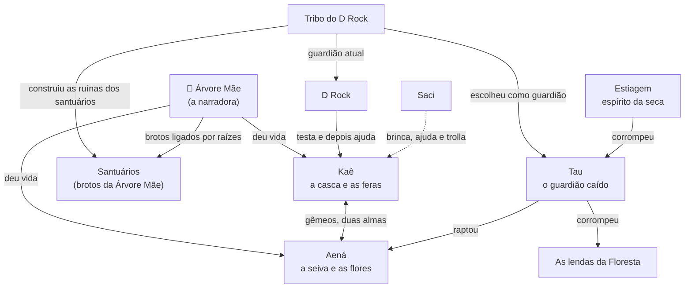
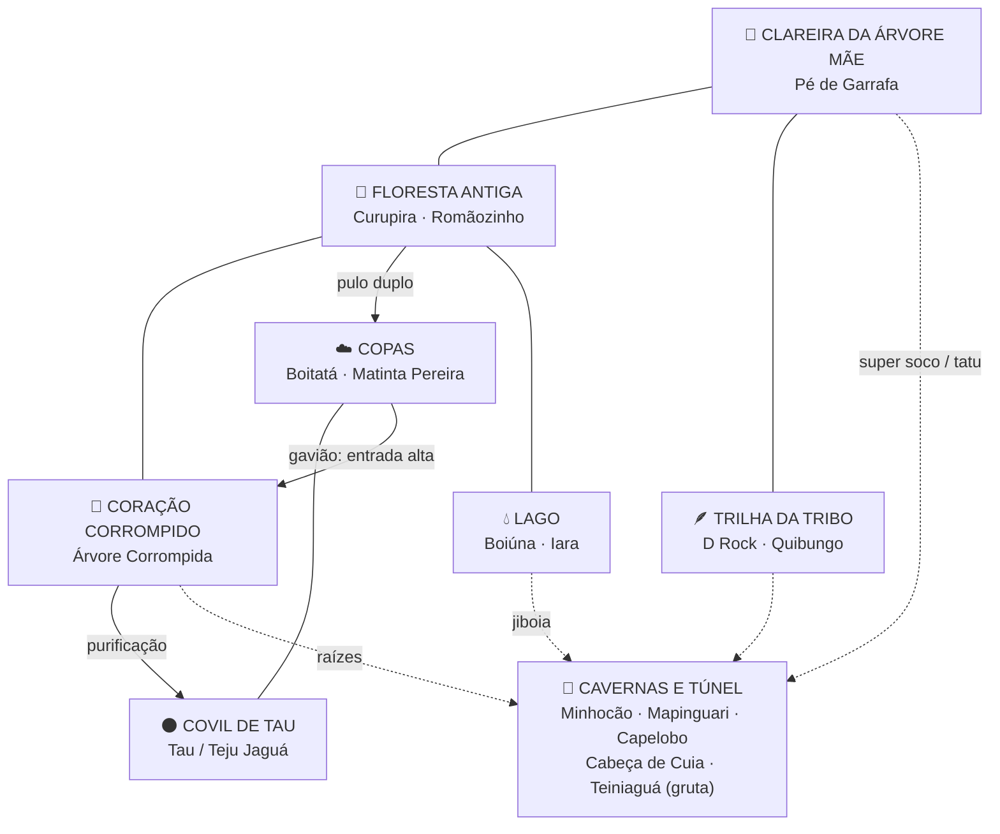
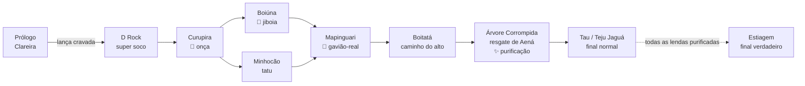
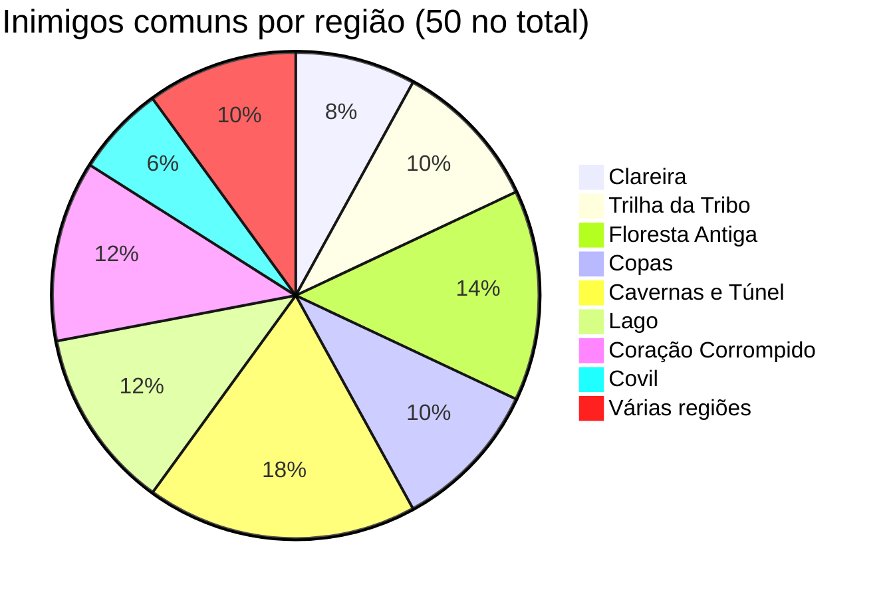

# Crônica da Floresta — o livro do mundo do jogo

*Contada pela voz da Árvore Mãe.*

Organizado pelo Claude em 01/11/2026 a partir de tudo o que foi decidido:
- `docs/brainstorm-mundo-interligado.md`;
- `docs/brainstorm-jogo.md`;
- `docs/historia.md`;
- `referencias/lendas-do-brasil.md`;
- `referencias/fauna-e-biomas.md`;
- `referencias/bestiario-ideias.md`.

> **Como ler:**
> - Este é um texto de **mundo** (lore), escrito como história.
> - O que é **decisão do Gabriel** está nos documentos de origem.
> - Os trechos que o Claude **inventou para costurar** a história estão marcados com ✦ e listados no fim ("Invenções para aprovar").
> - **Pendentes:** o **nome da floresta** aparece como *a Floresta*; o **título do jogo** e o nome do **espírito da seca** ("Estiagem") são provisórios.
> - As lendas brasileiras aqui são **reinterpretadas**. Nenhuma tenta recontar a lenda original, e os seres sagrados indígenas não viram inimigos comuns.

---

## Os gráficos do mundo

### Quem é quem

### Linha do tempo

```mermaid
flowchart LR
  E1["Era antiga<br/>A Árvore Mãe cresce<br/>e a Floresta nasce"] --> E2["A tribo chega<br/>e constrói ruínas<br/>em volta dos brotos ✦"]
  E2 --> E3["A grande seca<br/>Tau, o escolhido,<br/>busca o poder da Árvore"]
  E3 --> E4["A queda de Tau<br/>A Estiagem o corrompe"]
  E4 --> E5["Nascem Kaê e Aená<br/>da Árvore Mãe ✦"]
  E5 --> E6["O RAPTO<br/>início do jogo,<br/>de manhã"]
  E6 --> E7["A jornada<br/>vários dias e noites"]
  E7 --> E8["O resgate<br/>ao pôr do sol"]
  E8 --> E9["O Covil<br/>à noite"]
  E9 --> E10["A chuva volta<br/>(final verdadeiro)"]
```

### O mapa da Floresta (1.0)

### O caminho de Kaê (habilidades e chefes)

### Os 50 inimigos por região

---

## Livro I — A Árvore Mãe

*"Se bem me lembro…"*

Antes de qualquer trilha ou ruína, havia só a Árvore Mãe: uma árvore imensa, de luz azul, no coração da Floresta. A luz azul vem do material original. ✦ Das raízes dela corria a seiva que mantinha tudo vivo: a mata úmida, os campos de árvores tortas, o lago escuro, as cavernas cheias de raízes.

✦ Onde as raízes chegavam perto da superfície, nasciam **brotos**: pequenas árvores que guardavam um pouco da força da Mãe. Quem descansava perto de um broto recuperava as forças. Esses brotos são os **santuários** do jogo.

## Livro II — A tribo e as ruínas

Um povo chegou à Floresta e aprendeu a viver com ela: a **tribo**, que um dia teria o D Rock como guardião. Eles **construíram ruínas de pedra em volta dos brotos**, para proteger e honrar cada um. Por isso todo santuário é metade árvore, metade pedra antiga.

A tribo guardava a Floresta com máscaras, penas, lanças e trombetas. ✦ A cada geração ela escolhia **um guardião** para cuidar da Árvore Mãe.

> **A tribo é um povo fictício.** Não representa nenhum povo indígena real (decisão de cuidado do brainstorm).

## Livro III — A grande seca e a queda de Tau

Houve um tempo em que a chuva parou. O lago baixou, os campos racharam, os animais morreram e o povo também.

O guardião daquela geração se chamava **Tau**. Ele amava o seu povo e não suportou ver aquilo. Convenceu-se de que, se tomasse **todo o poder da Árvore Mãe para si**, poderia salvar os seus.

Foi aí que algo o ouviu: **a Estiagem**, o espírito da seca, uma fome antiga que quer a Floresta seca e morta. ✦ A Estiagem prometeu a Tau a força que ele queria e, aos poucos, entrou nele. Tau ficou mais forte e mais seco por dentro. Quando o povo percebeu, ele já não era guardião. Era **feiticeiro**.

Tau foi expulso. A tribo nunca mais confiou em escolhidos. ✦ O D Rock, o guardião seguinte, passou a **testar com os próprios punhos** qualquer um que dissesse proteger a Floresta.

## Livro IV — Duas almas

A Árvore Mãe, ferida pela seca, deu vida a dois filhos, **gêmeos**: ✦ talvez como resposta àquela seca.

- **Kaê**, *a casca e as feras*: forte, com cabelo verde despenteado, roupa escura de explorador e uma lança. Dentro dele dormem os espíritos dos animais da Floresta.
- **Aená**, *a seiva e as flores*: cabelo loiro e longo com flores, vestido claro e uma magia de luz que cura e purifica.

Separados, eram fortes. **Juntos, a magia deles era imbatível.** Esse é o sentido do nome *duas almas*.

## Livro V — O rapto

*(do texto original da faculdade, com os nomes novos)*

Certo dia, de manhã, Tau rompeu a barreira e **levou Aená**, deixando Kaê desacordado no chão. Tau quer **sacrificá-la**. ✦ A seiva e a luz de Aená seriam a única coisa capaz de abrir a Árvore Mãe para a seca. Com isso, a Floresta estaria perdida de vez.

Kaê acordou na Clareira, lembrou do que tinha acontecido, pegou a lança e partiu.

---

## Livro VI — As regiões e quem vive nelas

Cada região guarda **lendas** corrompidas por Tau e **criaturas** da Floresta tocadas pela corrupção, com veias roxas e olhos acesos. **Brilho roxo** quer dizer ataque que não se bloqueia; essa é uma proposta de linguagem visual. À noite, todas ficam mais ferozes.

### 🌳 Clareira da Árvore Mãe — onde tudo começa
*Mata Atlântica úmida, a manhã do rapto.*

A clareira sob a Árvore Mãe, onde os gêmeos cresceram. A corrupção ainda é pouca aqui, só o bastante para assustar.

| Criatura | A história dela |
|---|---|
| **Saúva-cortadeira** | carregam folhas em fila, como sempre fizeram. Só atacam, todas juntas, se alguém mexer com elas |
| **Calango** | corre, para, corre de novo; o primeiro bicho que Kaê aprende a pular |
| **Vaga-lume** | a corrupção deixou sua luz quente demais: solta faíscas ao ser tocado |
| **Broto espinhoso** | um broto que a seca deixou amargo; solta espinhos no próprio ritmo |

**Miniboss: Pé de Garrafa.** O protetor peludo das matas, de pernas em forma de garrafa. Corrompido, ele **deixa pegadas que levam a armadilhas**. ✦ Ensina Kaê a ler o chão. Depois de vencido, foge para a mata e não volta.

### 🪶 Trilha da Tribo — o teste
*Cerrado: campo aberto, árvores tortas, cupinzeiros; ruínas da tribo.*

O caminho até a aldeia. Os guerreiros da tribo vigiam tudo, porque a Floresta está em alerta.

| Criatura | A história dela |
|---|---|
| **Lanceiro tribal** | um guerreiro da tribo que arremessa lanças em quem não conhece. Depois do D Rock, vira amigo (sua lembrança) |
| **Arqueiro tribal** | atira flechas em diagonal do alto das plataformas de madeira. Também vira amigo |
| **Quati ladrão** | um bicho esperto que rouba o que Kaê carrega e foge |
| **Seriema** | corre muito e dá bicadas certeiras |
| **Cupinzeiro vivo** | um cupinzeiro tomado pela corrupção que solta nuvens de cupins voadores |

**Miniboss: Quibungo.** Um ser enorme que agarra e arremessa quem entra no seu caminho; ele fica aberto quando erra o agarrão. Depois de vencido, foge e some.

**CHEFE PRINCIPAL: D ROCK.** Entra gritando **"D ROCKKKK!"**. É o **guardião da tribo**, musculoso, de máscara com penas. Joga pedras, provoca abalos sísmicos, cospe fogo ✦ (*fogo sagrado*, talvez um presente do Boitatá) e tira a **trombeta** das costas para chamar lanceiros e arqueiros. **Nunca foi vilão**: só quer saber se Kaê é forte o bastante. Ao perder, entrega o **super soco**, conta a história de Tau ✦ e libera as **raízes da Árvore Mãe**, a viagem rápida entre santuários.

### 🌿 Floresta Antiga — o coração verde
*Mata Atlântica densa: neblina, bromélias, árvores gigantes. Liga quase todas as regiões.*

| Criatura | A história dela |
|---|---|
| **Jaguatirica** | agacha, balança a cauda e salta; a corrupção a deixou faminta |
| **Bugio** | o grito dele vira uma onda que empurra; joga frutos podres. À noite, o grito atordoa |
| **Jararaca na grama** | só a cabeça aparece, até o bote |
| **Perereca venenosa** | as cores vivas avisam: onde ela pula, fica uma poça tóxica |
| **Aranha-armadeira** | levanta as patas da frente antes de saltar |
| **Taturana no galho** | parada, quieta; encostar faz sangrar |
| **Bromélia carnívora** | parece uma plataforma, até abrir a boca |

**Miniboss: Romãozinho.** Um menino travesso e cruel que joga pedras e foge pelas árvores; a luta é uma perseguição. Depois de vencido, foge e some.

**SUBCHEFE: CURUPIRA.** O protetor das matas, de pés virados para trás. Corrompido, ele **testa Kaê com ilusões**: pegadas falsas e direções invertidas. Vencido, entrega o espírito da **onça-pintada preta**: correr pela Floresta. Depois do resgate, Kaê e Aená voltam e o **purificam**; ele volta a ser o guardião da mata, agora um NPC.

### ☁️ Copas — o alto da Floresta
*Dossel amazônico, galhos, cipós, vento; os desafios de precisão.*

| Criatura | A história dela |
|---|---|
| **Tucano** | o bico brilha antes do mergulho |
| **Macaco-aranha** | balança entre galhos e joga castanhas; quando apanha, foge |
| **Morcego-vampiro** | gruda em Kaê e só solta com uma esquiva |
| **Harpia corrompida** | rara: agarra Kaê e o solta do alto. É a sombra do gavião que mora nele |
| **Casa de marimbondo** | enquanto a casa existir, as vespas não acabam |

O **cipó vivo** que balança é um perigo do cenário, não um inimigo.

**Miniboss: Matinta Pereira.** Só aparece **à noite**: uma feiticeira que vira pássaro. O **assobio** anuncia que ela chegou. Corrompida por Tau, ela também é **amaldiçoada**; depois do resgate, a purificação a liberta e ela vira NPC.

**SUBCHEFE: BOITATÁ.** A serpente de fogo que guarda o alto da Floresta e o caminho até o Covil. Vencido, abre a passagem. Purificado depois, volta a ser o fogo que protege a mata, não o que a queima.

### 🦇 Cavernas e Túnel — o mundo de baixo
*Uma rede embaixo da Floresta inteira: calcário, raízes da Árvore Mãe, rios subterrâneos. O túnel é uma lembrança do jogo original.*

| Criatura | A história dela |
|---|---|
| **Morcegos** | dormem no teto e acordam com barulho ou luz |
| **Escorpião-amarelo** | em grupos; a cauda sobe e treme antes da picada |
| **Surucucu** | a maior serpente peçonhenta; o bote vem de longe, saindo de buracos |
| **Caranguejeira** | quando ameaçada, solta uma nuvem de pelos que queima |
| **Cascavel** | **o guizo avisa** antes do bote. Quem presta atenção ao som sobrevive |
| **Tatu-peba** | rola como bola e quica nas paredes, o oposto corrompido do tatu de Kaê |
| **Cristal corrompido** | formações que a seca endureceu; disparam estilhaços, e o super soco quebra |
| **Caboclo d'Água** | no trecho alagado do túnel, puxa para o fundo |
| **Minhoca gigante** | atravessa a terra fofa e deixa túneis que o tatu aproveita |

**Miniboss: Capelobo.** Corpo de gente e focinho de tamanduá; ataca no escuro. Depois de vencido, foge.

**Miniboss: Cabeça de Cuia**, no túnel alagado. Um menino **amaldiçoado** que sai da água e volta. A purificação, depois do resgate, **quebra a maldição**, e ele vira NPC.

**Miniboss: Teiniaguá**, numa **gruta secreta** que só o tatu abre. A lagartixa encantada com uma pedra brilhante na cabeça, que lança reflexos de luz. Purificada, o **encanto se quebra** e ela vira NPC. ✦ Guarda uma runa rara.

**SUBCHEFE: MINHOCÃO.** A serpente que vive sob o barro e **surge do chão**. Ensina Kaê a ler a terra fofa e entrega o espírito do **tatu-canastra**: cavar e achar segredos.

**SUBCHEFE: MAPINGUARI**, nas **Cavernas profundas**, que só se alcançam com a jiboia e o tatu. Gigante, peludo, com um olho na testa e uma boca na barriga; o bafo atordoa. Vencido, entrega o **gavião-real**, o último poder antes do resgate.

### 💧 Lago — as águas escuras
*Pantanal e várzea: aguapés, troncos boiando, a cheia.*

| Criatura | A história dela |
|---|---|
| **Piranhas** | um cardume no fundo que persegue quem nada |
| **Poraquê** | a água brilha, e então vem o choque |
| **Jacaré** | finge ser tronco. Kaê aprende a diferenciar |
| **Tuiuiú** | voa baixo sobre a água e bica |
| **Sucuri-amarela** | enrola e aperta até Kaê se soltar |
| **Ariranhas** | uma família de três, rápida na água |

O **aguapé** que afunda é um perigo de travessia, não um inimigo.

**Miniboss: Iara.** O canto dela puxa Kaê para a água. Corrompida e **encantada**, ela é libertada pela purificação depois do resgate e vira NPC.

**SUBCHEFE: BOIÚNA, a Cobra Grande.** Vive nas rochas do lago e afunda o que flutua: na luta, **afunda as plataformas**. Vencida, entrega o espírito da **jiboia**: mergulhar, passar por frestas e subir troncos. Purificada, volta a guardar o lago.

### 🥀 Coração Corrompido — onde a seca venceu
*A mata verde virou caatinga seca e espinhosa. É o pôr do sol.*

Aqui a corrupção é mais forte: a Floresta perdeu as folhas e ficou cinza e cheia de espinhos. É onde Tau **prendeu Aená**.

| Criatura | A história dela |
|---|---|
| **Corpo-seco** | árvores mortas que andam; só a purificação acaba com elas de vez |
| **Mandacaru** | o cacto dispara espinhos em leque |
| **Urubu** | circula no alto e mergulha quando Kaê está fraco |
| **Raiz estranguladora** | a terra racha e a raiz prende |
| **Servo encapuzado** | seguidores de Tau, com magia roxa, que invocam raízes |
| **Lobo-guará** | pernas longas, ataca em dupla. À noite, uiva e chama outro |

**CHEFE PRINCIPAL: A ÁRVORE CORROMPIDA**, ao **pôr do sol**. Finca as raízes e solta vinhas (lembrança do original). É a carcereira de Aená. Ao ser vencida, liberta a irmã, e os gêmeos se reencontram. Desperta a **purificação**, a magia dos dois juntos.

### 🌑 Covil de Tau — o topo, à noite
*No ponto mais alto da Floresta.*

| Criatura | A história dela |
|---|---|
| **Servo de elite** | protegido por um escudo de magia; o super soco quebra |
| **Gárgula de pedra-raiz** | estátua da tribo que a corrupção acordou; só se mexe quando Kaê passa ✦ |
| **Eco do feiticeiro** | uma cópia sombria de Tau que some ao ser atingida e reaparece |

Os **meteoros menores** que caem do céu são um perigo; a sombra no chão avisa onde vão cair.

**CHEFE FINAL: TAU.**
- **Fase 1: Tau encapuzado.** O guardião caído, com magia e projéteis. Ele acredita que está certo.
- **Fase 2: Tau, o Teju Jaguá.** Ele absorve a seca e vira o **lagarto encapuzado com traços de cão**, senhor das cavernas, com garras e **meteoros**.
  - O nome vem da mitologia guarani, em que o Teju Jaguá é filho de Tau. Aqui é uma reinterpretação.

### Criaturas que andam por toda a Floresta

| Criatura | A história dela |
|---|---|
| **Mula sem cabeça** | à noite, uma investida reta com rastro de fogo; um animal tomado pela corrupção |
| **Tocandira** | a formiga gigante cuja picada atordoa |
| **Besouro-hércules** | levanta com o chifre e joga longe; por trás fica indefeso |
| **Louva-a-deus** | camuflado nas folhas; golpe duplo e rápido |
| **Fungo de saúva** | nuvens de esporos perto dos formigueiros |

---

## Livro VII — O Saci

O Saci **não é inimigo**. Ninguém sabe de que lado ele está, nem ele.

- Aparece nos santuários e dá **um item aleatório**, ou uma "pedra comum" só para rir.
- **Rouba** algo e foge; se Kaê o pega, ele devolve com um bônus.
- Dá **dicas** que podem ser verdade ou pegadinha.
- Às vezes aparece **rindo, num redemoinho**, no fim de uma viagem pelas raízes.
- Se alguém pegar a **carapuça** dele, ganha um desejo: aqui, uma **runa com o tornado do Saci**.
- Quando ele está por perto, ouve-se o **assobio**.

---

## Livro VIII — O tempo da Floresta

- O jogo começa **de manhã**, com o rapto. A jornada dura **vários dias**.
- **À noite**, a corrupção fica mais forte: as criaturas ficam mais ferozes.
- Nos santuários, Kaê pode **descansar** até de manhã ou até a noite.
- Cada chefe principal tem a sua hora:
  - D Rock **de dia**;
  - Árvore Corrompida **ao pôr do sol**;
  - Tau **à noite**.
- Há três formas de viver essa história:
  - **História:** quase sempre de dia;
  - **Aventura:** o dia e a noite correm normalmente;
  - **Desafio:** a jornada inteira à noite, até os chefes.

---

## Livro IX — Os dois finais

### O final da jornada (final normal)
Tau cai no Covil. Os gêmeos, juntos de novo, purificam a Floresta. A Árvore Mãe encerra a história, e na aldeia o D Rock comemora com a tribo.

### O final verdadeiro
Para quem **purificou todas as lendas**: Curupira, Boiúna, Minhocão, Mapinguari, Boitatá, Matinta, Iara, Cabeça de Cuia e Teiniaguá.

Depois de Tau cair, **o espírito da Árvore Mãe aparece** e o purifica. Então a **Estiagem** sai do corpo dele: a seca que estava por trás de tudo. **Kaê e Aená lutam juntos, com a Árvore Mãe ao lado.**

Quando a Estiagem cai, **a chuva volta à Floresta**. Tau, curado, volta a ser guardião junto com a tribo. E a Árvore Mãe revela o que estava escondido desde a primeira frase:

*"…se bem me lembro. Fui eu que contei esta história a vocês."* ✦

---

## Livro X — O que vem depois (regiões depois do 1.0)

| Região | O que vive lá |
|---|---|
| **Brejo** | **Mbói Tu'ĩ**, a serpente-papagaio, guardiã dos pântanos na mitologia guarani (**subchefe**); sapo-cururu gigante, enguia, garça |
| **Raízes Profundas** | larvas, cupim-rainha, raízes vivas, fungos luminosos |
| **Ruínas sob o Lago** | pirarucu gigante, estátuas animadas da tribo ✦ |
| **Pico Nevado** | campo alto e gelado, como o Pampa; ema, quero-quero que avisa os outros, graxaim (a confirmar), geada |
| **Bosque de Aenia** | flores corrompidas que encantam; um lugar ligado à magia dela ✦ |

Planejados também para depois: o **planar** do gavião e o **gancho de cipó** de Kaê.

---

## Números do mundo (1.0)

| O quê | Quantos |
|---|---|
| Regiões | 8 |
| Chefes principais | 3 (D Rock, Árvore Corrompida, Tau), mais a Estiagem no final verdadeiro |
| Subchefes (lendas) | 5 |
| Minibosses (lendas) | 8 |
| Inimigos comuns | 50 (núcleo de 25 primeiro) |
| Lendas purificáveis | 9 (5 subchefes e 4 minibosses amaldiçoados) |
| Habilidades | 7 (lança cravada, super soco, onça, jiboia, tatu, gavião-real, purificação) |
| Animais na tecla R | 3 (onça, tatu, jiboia) |
| Espaços de runa | de 2 a 5 |

---

## Invenções para aprovar (✦)

Trechos que o Claude criou para costurar a história. **Nada disso está decidido.**

1. **Brotos:** os brotos nascem onde as raízes chegam perto da superfície, e descansar perto deles recupera as forças.
2. **Escolha do guardião:** a tribo escolhia um guardião a cada geração.
3. **Como a Estiagem age:** ela "ouviu" Tau, prometeu força e entrou nele aos poucos.
4. **Teste do D Rock:** depois de Tau, o D Rock passou a testar no braço quem dissesse proteger a Floresta.
5. **Nascimento dos gêmeos:** os gêmeos nasceram depois da queda de Tau, como resposta da Árvore à seca.
6. **Sacrifício:** Tau precisa de Aená porque a seiva e a luz dela abririam a Árvore Mãe para a seca.
7. **O fogo do D Rock:** seria um "fogo sagrado", talvez presente do Boitatá (ideia que veio do brainstorm com o Gemini).
8. **D Rock conta a história:** é ele quem conta a história de Tau a Kaê.
9. **Gárgulas:** são estátuas da tribo acordadas pela corrupção.
10. **Teiniaguá:** guarda uma runa rara.
11. **Frase final:** a frase final da Árvore Mãe.
12. **Regiões novas:** estátuas da tribo nas Ruínas sob o Lago; o Bosque de Aenia ligado à magia dela.
13. **Brilho roxo:** brilho roxo = ataque que não se bloqueia (linguagem visual sugerida).
